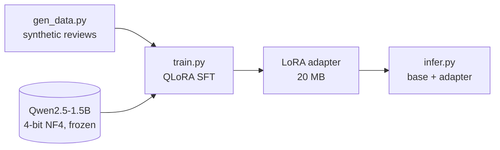

# Qwen2.5 QLoRA — Vietnamese Text Classification

Fine-tuning **Qwen2.5-1.5B-Instruct** with **QLoRA** (4-bit NF4 base model + LoRA adapters) to classify
Vietnamese product reviews as positive / negative — on a single **11 GB RTX 2080 Ti**.
The same pipeline can be retargeted to content moderation by changing the labels and data.


## Pipeline



## Setup

| | |
|---|---|
| Base model | `Qwen/Qwen2.5-1.5B-Instruct` |
| Quantization | 4-bit NF4, double quantization, fp16 compute (bitsandbytes) |
| LoRA | r = 16, alpha = 32, dropout = 0.05 on `q_proj`, `k_proj`, `v_proj`, `o_proj` |
| Training | TRL `SFTTrainer`, 3 epochs, batch size 8, lr 2e-4, max length 256 |
| Data | 119 unique synthetic samples (108 train / 11 val), class-balanced |
| Prompt format | instruction → label, rendered with the model's own chat template |

**Synthetic data** (`src/gen_data.py`): reviews are generated by slot-filling 8 templates per class with
10 sentiment phrases, then shuffled and deduplicated (fixed seed for reproducibility).

**Turing GPU note:** RTX 20-series cards have no bf16 support, so the model is loaded and computed in fp16,
mixed-precision flags are left off (avoids a GradScaler / bf16 error), and the 4-bit model is prepared with
`prepare_model_for_kbit_training`.

## Results

| Metric | Start | End |
|---|---|---|
| Training loss | 3.38 | 0.47 |
| Token accuracy | 0.46 | 0.93 |

> **Caveat:** both values are training-set numbers, and they are computed over the whole chat-formatted sequence —
> including the fixed instruction, which is identical in every sample — not only over the label. They show that
> training converged, not how well the model classifies. The 11 validation samples are not used by the trainer.

The adapter is **20 MB**, versus ~3 GB for the full fp16 model. As a sanity check, `src/infer.py` classifies
5 hand-written reviews correctly — several resemble the training templates, so this is not an evaluation.

## Quickstart

Requires an NVIDIA GPU (tested on RTX 2080 Ti, 11 GB).

```bash
git clone https://github.com/lmtndy/qwen-qlora-vietnamese.git
cd qwen-qlora-vietnamese
python -m venv .venv && source .venv/bin/activate
pip install -r requirements.txt

python -m src.gen_data    # 1) generate data/train.jsonl, data/val.jsonl
python -m src.train       # 2) QLoRA fine-tune → adapter/
python -m src.infer       # 3) classify sample reviews with base model + adapter
```

Hyperparameters, labels and the instruction prompt are in `src/config.py`.

## Project structure

```
├── src/
│   ├── config.py      # model, labels, LoRA + training hyperparameters
│   ├── gen_data.py    # synthetic dataset generator
│   ├── train.py       # QLoRA fine-tuning → adapter/
│   └── infer.py       # load base model + adapter, classify examples
└── NOTES.vi.md        # personal learning notes (Vietnamese)
```

## Limitations & next steps

Template-generated data is narrow and easy, so the numbers above show the model fitting this data — not
real-world accuracy.

- [ ] Compute the loss on the answer only (prompt/completion data) and evaluate on a real, human-labeled Vietnamese review dataset with precision / recall / F1, against TF-IDF + logistic regression and zero-shot baselines on the same split
- [ ] Retarget to content moderation (toxic / normal) with real data
- [ ] Merge the adapter into the base model and serve it behind an API
